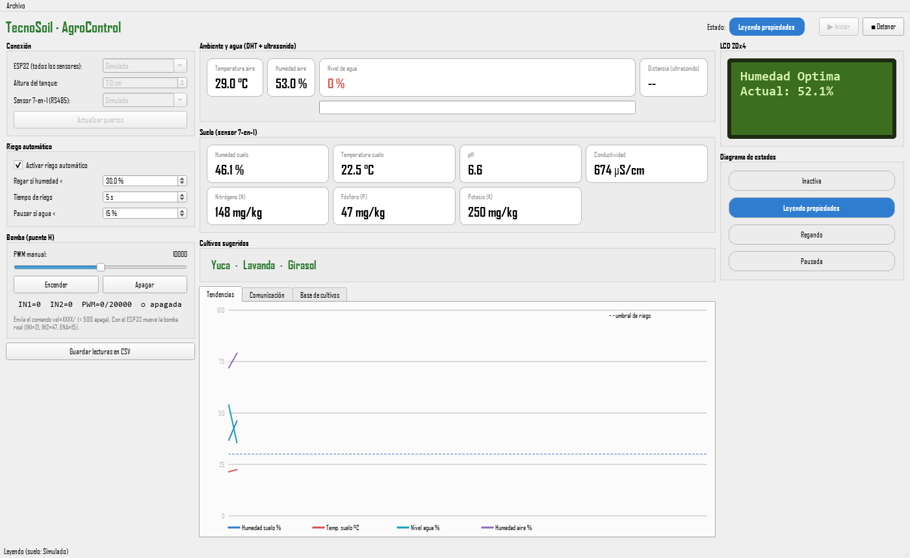

# TecnoSoil · AgroControl

Sistema de monitoreo de suelos y riego automático con un ESP32-S3 e interfaz gráfica de escritorio (HMI).
Proyecto del curso de Computación e Interfaces, Ingeniería Biomédica, Universidad Tecnológica de Bolívar (2026).

**Integrantes:** Elibeth Dominguez Quiroz · Junior José Sarmiento Prada · Samuel Meza Muñoz ·
Luis Romero Contreras · Isabella Barrera Babilonia



## ¿Qué hace?

- Mide las propiedades del suelo con un sensor **7 en 1** (humedad, temperatura, pH, conductividad y N, P, K).
- Mide temperatura y humedad del aire (**DHT22**) y el nivel del tanque de agua (**HC-SR04**).
- **Recomienda cultivos** comparando el suelo con una base de 37 plantas.
- **Riega automáticamente** con una bomba (puente H L298N) cuando la humedad baja del umbral, y se pausa si
  el tanque tiene poca agua.
- Muestra todo en una **LCD 20x4** física y en la interfaz de PC (PySide6), con gráficas de tendencia,
  diagrama de estados y exportación a CSV.

## Estructura del repositorio

| Carpeta | Contenido |
|---|---|
| [`app/`](app) | Programa de PC: lógica POO (`compu_int.py`), interfaz (`interfaz_tecnosoil.py`), conexión con el ESP32 (`esp32_tecnosoil.py`), programa que corre en la placa (`esp32_puente.py`) y pruebas |
| [`esp32_pruebas_por_sensor/`](esp32_pruebas_por_sensor) | Programas MicroPython para probar cada sensor por separado |
| [`laboratorios/`](laboratorios) | Laboratorio 2: ESP32 → interfaz Python (Tkinter) → CSV, con su informe |
| [`docs/`](docs) | Informe del proyecto y diagramas (flujo, clases, estados, actividades, secuencia y casos de uso) |

## Conexiones (ESP32-S3)

| Componente | Pines |
|---|---|
| DHT22 | Datos → GPIO 4 |
| HC-SR04 | Trig → GPIO 5 · Echo → GPIO 6 |
| Módulo RS485 (MAX485) + sensor 7 en 1 | DI → GPIO 17 · RO → GPIO 16 · DE y RE → GPIO 7 · VCC 3.3 V · A/B al sensor (4800 baudios, dirección 1) |
| Puente H L298N + bomba de 5 V | IN1 → GPIO 21 · IN2 → GPIO 47 · ENA → GPIO 15 (o jumper puesto) |
| LCD 20x4 I2C (PCF8574, 0x27) | SDA → GPIO 8 · SCL → GPIO 9 · VCC 5 V |

Todos los GND van unidos. La placa usa MicroPython; la interfaz le envía `esp32_puente.py` al conectarse,
así que no hace falta guardarlo en la placa.

## Cómo ejecutarlo

```
cd app
pip install -r requirements.txt
python interfaz_tecnosoil.py                     # con sensores simulados
python interfaz_tecnosoil.py --puerto-esp32 auto # con el ESP32 conectado (o abrir_interfaz_esp32.bat)
```

## Pruebas

```
cd app
python -m unittest -v test_tecnosoil   # 33 pruebas unitarias, no necesitan la placa
python prueba_hardware.py              # prueba cada componente conectado al ESP32
```

Más detalles de la interfaz y de las clases en [`app/README.md`](app/README.md).
